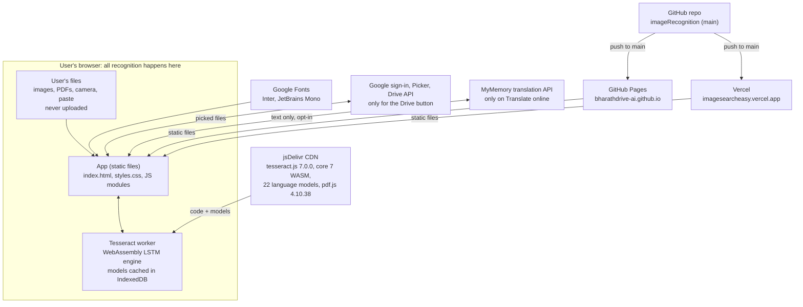
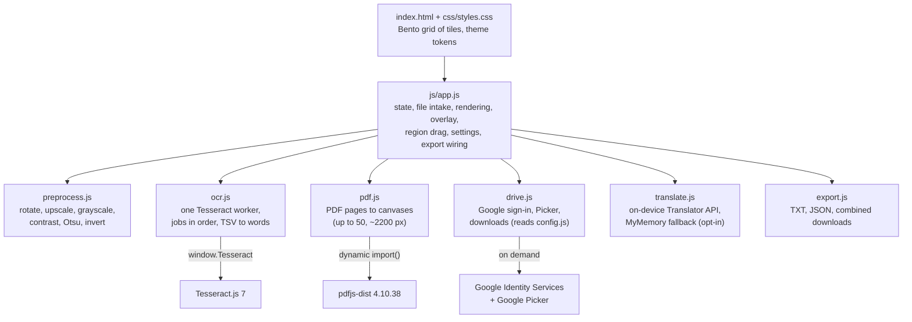
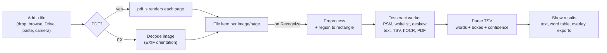

# Architecture

TextVision AI is a static, client-side OCR web app. Tesseract.js 7 reads images and PDFs inside the user's browser, so files never leave the device and there is no server, database or build step.

| Resource | Link |
| --- | --- |
| Source | https://github.com/bharathdrive-ai/imageRecognition |
| Live (GitHub Pages) | https://bharathdrive-ai.github.io/imageRecognition/ |
| Live (Vercel) | https://imagesearcheasy.vercel.app/ |

## System context

The browser downloads the app's static files from GitHub Pages or Vercel, and the engine, language models and pdf.js from jsDelivr. The user's images and PDFs are read locally and never uploaded. Files picked from Google Drive download straight from Google's Drive API into the browser.

## Components

`app.js` is the only module with state or DOM access. The other five are small single-purpose modules it imports.

| File | Responsibility |
| --- | --- |
| `index.html` | Bento grid of 12 tiles (hero, search, stats, upload, viewer, results, files, language & layout, image settings, fine-tuning, translate, export); loads `tesseract.min.js` then `js/app.js` |
| `css/styles.css` | Bento Grid theme: light/dark tokens, grid areas for 4 columns (desktop), 2 (tablet) and 1 (phone) |
| `js/app.js` | State, file intake (drop, browse, paste, camera, sample; auto-recognize queue), rendering, overlay, region selection, cross-file search (regex over each file's text and translation, word highlights on the image), settings, theme, exports |
| `js/ocr.js` | Creates and reuses one Tesseract worker, switches languages, sets parameters, serializes jobs, parses TSV |
| `js/preprocess.js` | Canvas cleanup: 90° rotation, upscaling (max 5000 px), grayscale, contrast stretch, Otsu threshold, invert, dark-image check |
| `js/pdf.js` | Lazily imports pdf.js and renders up to 50 pages at about 2200 px wide |
| `js/drive.js` | Loads Google's sign-in and Picker scripts on demand, gets a `drive.file` token, shows the Picker, downloads picked files from the Drive API |
| `js/config.js` | Public Google client ID, API key and project number; blank values hide the Drive button |
| `js/translate.js` | Translation between English and Indian languages: browser Translator API on the device (with timeouts), else MyMemory after the user clicks **Translate online** |
| `js/export.js` | Blob downloads, safe file names, JSON and combined-text builders |
| `privacy.html` | Privacy policy linked from the header and from the Google consent screen |

## Recognition pipeline

1. **Intake:** PDFs are rendered page by page with pdf.js. Images are decoded with `createImageBitmap`, which applies EXIF orientation. Files picked from Google Drive are downloaded first, then follow the same path. Each page or image becomes a file item.
2. **Preprocess:** `preprocess()` builds a new canvas with the chosen cleanup steps. A selected region becomes a pixel `rectangle` in that canvas.
3. **Recognize:** `ocr.js` creates the worker on first use and calls `reinitialize` when languages change. It sets the page layout mode, whitelist and spacing, then runs `recognize` with `rotateAuto` and asks for text, TSV, hOCR and PDF output. Logger events drive the progress bar and the status pill.
4. **Parse:** level-5 TSV rows become words with boxes and confidence. Lines are renumbered across the page.
5. **Show:** the text panel, words table and overlay draw from `item.result`. Boxes are scaled to the displayed canvas and rotated back by the deskew angle.

## Data model and state

All state lives in memory in one `state` object in `app.js`: file items, the active item id, the preview mode, the chosen languages and a running flag.

| Item field | Purpose |
| --- | --- |
| `id`, `name` | Identity and the name shown in the file list |
| `source` | Decoded image canvas, with EXIF orientation applied |
| `rotation`, `base` | Manual 90° rotation and the rotated canvas used for everything else |
| `thumb` | 80 × 80 JPEG data URL for the file list |
| `status`, `progress`, `message` | queued / running / done / error, live progress, error text |
| `region` | Selected area as fractions (0–1) of the image, or null |
| `preview`, `previewKey` | Cached processed canvas and the settings it was made with |
| `result` | text, words, confidence, TSV, hOCR, PDF bytes, `rotateRadians`, processed size, languages, time |
| `editedText` | The user's edits to the text, used by copy and export |

Settings (`ocr-settings-v1`) and the theme (`ocr-theme`) are kept in `localStorage`, with every access wrapped in try/catch. Files and results are not saved.

**Coordinate spaces:**

1. **Base:** the rotated original. The region is stored as fractions of it.
2. **Processed:** the base × the upscale factor. Tesseract's boxes come back in these pixels.
3. **Deskewed:** Tesseract rotates by `rotateRadians` before reading, so the overlay rotates the boxes by `−rotateRadians` around the centre and inverts that rotation for hover hit-testing.

## Key design decisions

| Decision | Chosen | Why | Trade-off |
| --- | --- | --- | --- |
| Where OCR runs | Browser (Tesseract.js, WebAssembly) | No uploads, no server cost, any static host | Speed depends on the device; about 4–5 MB on first use |
| Build tooling | None: ES modules, libraries from a CDN | Push to `main` is the whole release | No bundling of our code; needs a CDN at runtime |
| Engine count | One shared worker, jobs in order | Models load once; predictable memory on phones | Batches run one after another |
| Word data | Parse TSV output | A stable format; Tesseract.js 6+ returns only text by default and changed its JSON shape | Line structure is rebuilt from TSV ids |
| Preprocessing | Own canvas code | Fast, no extra library, the processed image can be previewed | Main thread; capped at 5000 px per side |
| Deskew | Tesseract `rotateAuto` | Measured by the engine from the text lines | Overlay must rotate boxes back |
| PDF input | pdf.js loaded on demand | Keeps the first load small | 50-page limit |
| Searchable PDF | Tesseract's PDF renderer | Exact text layer with no extra code | Built for every job |
| Translation | Browser Translator API on the device; MyMemory only on an explicit **Translate online** click | Keeps text private where the browser can translate locally; works everywhere else | Online mode sends text to a third party (disclosed in the UI and privacy policy); free tier limit about 5,000 characters a day |
| Google Drive import | Google Picker, `drive.file` scope, browser fetches picked files | No server; narrowest Drive scope, so no Google review | Needs a Google Cloud project and a sign-in pop-up; HEIC photos and Google Docs files can't be read |

## Deployment

| Environment | Host | Source |
| --- | --- | --- |
| Production | GitHub Pages (legacy build, `.nojekyll`) | `main`, repo root |
| Production | Vercel: team driveAI, project `imagesearcheasy`, preset "Other" | `main` through the Vercel GitHub app |
| Local | `python -m http.server 8790` | Working copy (`file://` won't load ES modules) |

**Google Cloud (Drive import):** project `image-text-recognition-511415` has the Picker and Drive APIs enabled. Its consent screen is in production with only the `drive.file` scope and links to `privacy.html`. The OAuth web client and the Picker-restricted API key accept requests only from the two live sites and `localhost:8790`.

Runtime dependencies are pinned and served by jsDelivr: `tesseract.js@7.0.0`, `tesseract.js-core@7`, `@tesseract.js-data/<lang>/4.0.0_best_int`, and `pdfjs-dist@4.10.38`.

## Limitations and future work

- Handwriting, stylised fonts and dotted leader lines read poorly; this is a Tesseract limitation.
- Batches run one file at a time; PDFs stop at 50 pages; results are lost on reload.
- The first run needs a network connection to download the engine.

Possible improvements: a 2–4 worker scheduler, a merged multi-page searchable PDF, offline support with self-hosted models and a service worker, preprocessing in a Web Worker, several regions per image, and an optional (clearly marked) cloud fallback for handwriting.

## Links

Dashboard and Google Cloud links open only for the owner account.

| Area | What | URL |
| --- | --- | --- |
| Live app | Vercel | https://imagesearcheasy.vercel.app |
| Live app | GitHub Pages | https://bharathdrive-ai.github.io/imageRecognition/ |
| Live app | Privacy policy | https://imagesearcheasy.vercel.app/privacy.html |
| Code and docs | GitHub repo | https://github.com/bharathdrive-ai/imageRecognition |
| Code and docs | Architecture (Claude Doc) | https://claude.ai/code/artifact/9e90526f-4bb2-46ac-bbdb-0727260cb836 |
| Hosting | Vercel project | https://vercel.com/drive2/imagesearcheasy |
| Hosting | GitHub Pages settings | https://github.com/bharathdrive-ai/imageRecognition/settings/pages |
| Google Cloud | Credentials (OAuth client, API key) | https://console.cloud.google.com/apis/credentials?project=image-text-recognition-511415 |
| Google Cloud | Consent screen and audience | https://console.cloud.google.com/auth/audience?project=image-text-recognition-511415 |
| Google Cloud | Enabled APIs | https://console.cloud.google.com/apis/dashboard?project=image-text-recognition-511415 |
| Users | Remove the app's Drive access | https://myaccount.google.com/permissions |
| Local | Dev server (`python -m http.server 8790`) | http://localhost:8790 |
